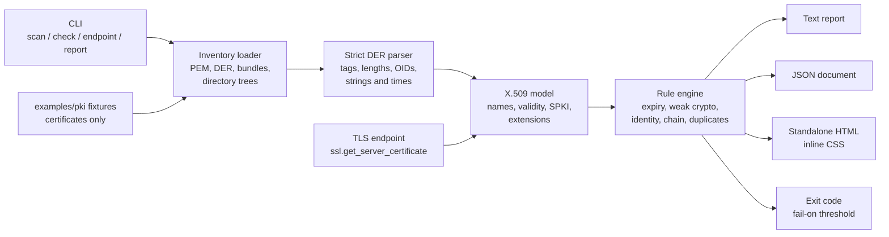

# cert-sentinel

An offline X.509 certificate inventory and expiry auditor for small PKI operators and lab environments: it parses PEM/DER certificates with a pure-Python DER parser, audits expiry and configuration risks, and reports findings as text, JSON or a standalone HTML page.

[](https://github.com/jeremydacosta-TechOptimist/cert-sentinel/actions/workflows/ci.yml)


Certificate inventories grow quietly: an old internal CA, a leaf signed with SHA-1, a self-signed certificate nobody remembers, a wildcard that is about to expire. Commercial scanners cover this but often require an agent, an account or a network path to a service. This project is the opposite: a single Python package with no runtime dependencies and no OpenSSL binding that reads certificate files directly, evaluates a fixed set of review rules, and fails a CI job with exit code 1 when a finding crosses the configured threshold. A committed lab PKI makes every check reproducible offline, and `--now` lets you audit a future or past date without touching the system clock.

## Features

- Strict DER TLV parser written from scratch: short and long definitive lengths, high-tag-number form, constructed versus primitive values, minimal-encoding checks and offset-aware errors for truncated or non-DER input.
- ASN.1 value decoders for INTEGER, BOOLEAN, BIT STRING, OCTET STRING, NULL, OBJECT IDENTIFIER, UTF8/Printable/IA5/Teletex/BMP strings, UTCTime and GeneralizedTime with `Z` or explicit offsets.
- X.509 model with ordered distinguished names, validity in aware UTC, signature algorithm OID and friendly name, RSA modulus bits, EC named curve, SAN (DNS, IP, email, URI), basic constraints, key usage, extended key usage, subject/authority key identifiers and AIA URLs.
- Inventory loader for PEM and DER files, multi-certificate bundles and recursive directory trees, with per-file load errors instead of an abort.
- Twelve audit rules in `checks.py`: expiry, expiry warning, not-yet-valid, MD5/SHA-1 signatures, RSA keys below 2048 bits, self-signed leaves, missing SAN, hostname mismatch (exact, wildcard one label, IP SAN, CN fallback), wildcard notices, duplicate fingerprints, missing issuer certificates, long validity and CA information.
- Text, JSON and standalone HTML reports; the HTML page has inline CSS, severity badges, the full certificate inventory and no external assets.
- TLS endpoint audit through `ssl.get_server_certificate` (or an SNI-aware stdlib TLS context with `--sni`), without certificate verification.
- CLI with `scan`, `check`, `endpoint`, `report` and `version`, `--json`, `--fail-on warning|error|none`, `--now ISO-8601` and exit codes for CI.

## Quick start

```powershell
git clone https://github.com/jeremydacosta-TechOptimist/cert-sentinel.git
cd cert-sentinel
python -m pip install -e .
python -m certsentinel version
```

```text
certsentinel 1.0.0
```

The console script `certsentinel` and `python -m certsentinel` are equivalent; the examples use the module form so they also work from a source checkout with `$env:PYTHONPATH = "src"`.

## Usage

### Audit a certificate inventory

```powershell
python -m certsentinel scan examples/pki
```

```text
cert-sentinel audit - 2026-11-16 17:41 UTC
8 certificate(s), 9 finding(s): 1 error, 3 warning, 3 notice, 2 info

CERTIFICATES
SUBJECT                    ISSUER                     NOT AFTER            KEY         SIGNATURE      SHA-256         
NetWatch Lab Intermedia... NetWatch Lab Root CA       2031-11-15 17:32 UTC RSA 2048    sha256RSA      99681527baaeb9ed
srv-b.example              NetWatch Lab Intermedia... 2026-12-06 17:32 UTC RSA 2048    sha256RSA      85321b8e975c3a50
selfie.example             selfie.example             2027-11-16 17:32 UTC RSA 2048    sha256RSA      52ba2279a74f9c7e
srv-a.example              NetWatch Lab Intermedia... 2027-11-16 17:32 UTC RSA 2048    sha256RSA      6d7b2006989eca1e
legacy-sha1.example        NetWatch Lab Intermedia... 2027-11-16 17:32 UTC RSA 2048    sha1RSA        7d506deabb7facf4
legacy-rsa.example         NetWatch Lab Intermedia... 2027-11-16 17:32 UTC RSA 1024    sha256RSA      c8dc2a4f59fd73c3
srv-a.example              NetWatch Lab Intermedia... 2027-11-16 17:32 UTC RSA 2048    sha256RSA      6d7b2006989eca1e
NetWatch Lab Root CA       NetWatch Lab Root CA       2036-11-13 17:32 UTC RSA 2048    sha256RSA      226f9ba10db23916

FINDINGS
SEVERITY RULE                        CERTIFICATE               MESSAGE
error    CERT-SMALL-RSA-KEY          legacy-rsa.example        RSA key is 1024 bits, below the 2048-bit minimum
warning  CERT-DUPLICATE              srv-a.example             duplicate certificate also loaded from examples/pki/leaf-server.pem
warning  CERT-EXPIRING               srv-b.example             certificate expires in 19 day(s) on 2026-12-06 17:32 UTC
warning  CERT-WEAK-HASH              legacy-sha1.example       signature uses SHA-1 (sha1WithRSAEncryption)
notice   CERT-LONG-VALIDITY          NetWatch Lab Intermedia...validity is 1825 days, above the 398-day browser limit
notice   CERT-LONG-VALIDITY          NetWatch Lab Root CA      validity is 3650 days, above the 398-day browser limit
notice   CERT-SELF-SIGNED            selfie.example            certificate is self-signed (subject equals issuer and no CA constraint)
info     CERT-CA-CERT                NetWatch Lab Intermedia...certificate is a CA (pathLenConstraint 0)
info     CERT-CA-CERT                NetWatch Lab Root CA      certificate is a CA (pathLenConstraint 1)
```

The command exits with code 1 because findings cross the default `warning` threshold; use `--fail-on error` or `--fail-on none` to change that. `--json` prints the same audit as a machine-readable document.

### Verify a hostname against a certificate

```powershell
python -m certsentinel check examples/pki/leaf-server.pem --host www.example
```

```text
cert-sentinel audit - 2026-11-16 17:41 UTC
1 certificate(s), 2 finding(s): 1 error, 1 warning, 0 notice, 0 info

CERTIFICATES
SUBJECT                    ISSUER                     NOT AFTER            KEY         SIGNATURE      SHA-256         
srv-a.example              NetWatch Lab Intermedia... 2027-11-16 17:32 UTC RSA 2048    sha256RSA      6d7b2006989eca1e

FINDINGS
SEVERITY RULE                        CERTIFICATE               MESSAGE
error    CERT-HOSTNAME-MISMATCH      srv-a.example             hostname 'www.example' does not match certificate names: DNS:srv-a.example, IP:192.0.2.10
warning  CERT-CHAIN-MISSING-ISSUER   srv-a.example             issuer certificate 'NetWatch Lab Intermediate CA' is not present in the scanned inventory
```

The `--host` value is matched against DNS SANs case-insensitively, wildcard SANs match exactly one label, and IP addresses are matched against iPAddress SANs. If a certificate has no SAN extension the subject common name is used as a fallback.

### Audit at a future date

```powershell
python -m certsentinel scan examples/pki/leaf.der --now 2030-01-01T00:00:00Z --fail-on error
```

```text
cert-sentinel audit - 2030-01-01 00:00 UTC
1 certificate(s), 2 finding(s): 1 error, 1 warning, 0 notice, 0 info

CERTIFICATES
SUBJECT                    ISSUER                     NOT AFTER            KEY         SIGNATURE      SHA-256         
srv-a.example              NetWatch Lab Intermedia... 2027-11-16 17:32 UTC RSA 2048    sha256RSA      6d7b2006989eca1e

FINDINGS
SEVERITY RULE                        CERTIFICATE               MESSAGE
error    CERT-EXPIRED                srv-a.example             certificate expired 776 day(s) ago on 2027-11-16 17:32 UTC
warning  CERT-CHAIN-MISSING-ISSUER   srv-a.example             issuer certificate 'NetWatch Lab Intermediate CA' is not present in the scanned inventory
```

### Generate the standalone HTML report

```powershell
python -m certsentinel report examples/pki --out examples/audit-report.html
```

```text
report written to examples/audit-report.html (7694 bytes)
```

The rendered report is committed at [examples/audit-report.html](examples/audit-report.html): one self-contained page with summary cards, severity badges, the finding table, the certificate inventory and load errors. The same audit is available as JSON with `python -m certsentinel scan PATH --json`, and as a live endpoint check via `python -m certsentinel endpoint HOST:PORT [--sni NAME]`.

Exit codes: `0` clean (or below the fail threshold), `1` findings at or above the threshold or a runtime failure, `2` bad usage.

## Architecture



The CLI collects file paths and either loads certificates through the inventory loader or fetches a live endpoint certificate. Bytes go through the strict DER parser, which produces TLV nodes without ever trusting a length; the X.509 model then decodes names, validity, public key details and extensions. The rule engine runs per-certificate checks plus inventory-wide checks (duplicates and missing issuers) and sorts findings by severity. Reporters render the same result model as aligned text, a JSON document or HTML, and the CLI turns the findings into an exit code. The TLS endpoint path reuses the same model and rules, so file-based and live audits share one implementation.

## Project layout

```text
cert-sentinel/
├── .github/workflows/ci.yml     # test matrix: Python 3.10 to 3.13
├── .gitignore
├── LICENSE
├── README.md
├── pyproject.toml
├── examples/
│   ├── audit-report.html       # rendered from the demo data
│   └── pki/
│       ├── README.md
│       ├── root-ca.pem
│       ├── intermediate-ca.pem
│       ├── leaf-server.pem
│       ├── leaf.der
│       ├── leaf-expiring-soon.pem
│       ├── leaf-sha1.pem
│       ├── leaf-small-key.pem
│       └── leaf-self-signed.pem
├── src/certsentinel/
│   ├── __init__.py
│   ├── __main__.py             # python -m certsentinel
│   ├── der.py                  # strict DER TLV parser and value decoders
│   ├── x509.py                 # certificate model, PEM/DER inventory loader
│   ├── checks.py               # expiry and configuration rule engine
│   ├── report.py               # text, JSON and HTML reporters
│   └── cli.py                  # argparse sub-commands and exit codes
└── tests/
    ├── fixtures/ec-leaf.pem    # EC P-256 certificate used by parsing tests
    ├── helpers.py
    ├── test_der.py
    ├── test_x509.py
    ├── test_inventory.py
    ├── test_checks.py
    ├── test_report.py
    ├── test_endpoint.py
    └── test_cli.py
```

## Testing

The suite uses `unittest.TestCase` classes only, so both runners work. No test touches the internet or runs OpenSSL: certificates are committed fixtures, and the endpoint tests mock `ssl.get_server_certificate` or the TLS context. Temporary files use `tempfile.TemporaryDirectory`.

```powershell
# from the repository root
$env:PYTHONPATH = "src"
py -3.13 -m pytest -q
python -m unittest discover -s tests -v
python -m compileall -q src tests
```

Captured with pytest 9.0.3 on Python 3.13 and unittest on Python 3.11:

```text
222 passed, 14 subtests passed in 0.92s
```

```text
Ran 222 tests in 0.588s

OK
```

Coverage includes DER length/tag edge cases and malformed input, every ASN.1 time and string variant, certificate field parsing for RSA and EC fixtures, all twelve rules with boundary conditions, hostname matching variants, duplicate and missing-issuer inventory checks, PEM/DER/bundle/directory loading, text/JSON/HTML rendering and escaping, endpoint parsing and retrieval with mocks, and the CLI end-to-end including exit codes and subprocess invocation. There are 222 test methods and 501 assertions. CI runs the suite on Python 3.10, 3.11, 3.12 and 3.13.

## Roadmap

- Cryptographic chain validation (RSA and ECDSA signature verification) instead of the current issuer-presence check.
- Optional CRL and OCSP checks driven by the AIA URLs, as a separate network-enabled command that leaves the offline scanner untouched.
- Configurable rule profiles, so a lab policy can adjust the expiry windows and silence rules that do not apply to a private PKI.

## Resumo em português (PT-PT)

- Inventário e auditoria de certificados X.509 totalmente offline, sem dependências externas nem ligação a OpenSSL: o parser DER é implementado em Python puro.
- Lê ficheiros PEM e DER, bundles e diretórios recursivos, expõe nomes, validade, chave pública (RSA ou curva EC), SAN, restrições, key usage, EKU, SKI/AKI e AIA.
- Aplica doze regras de auditoria, incluindo validade expirada ou a expirar, assinaturas MD5/SHA-1, chaves RSA pequenas, certificados autoassinados, falta de SAN, nomes de anfitrião, duplicados e ausência do emissor na cadeia.
- Gera relatórios em texto, JSON e HTML autónomo (com CSS embutido) e devolve códigos de saída 0, 1 e 2 adequados a pipelines de CI, com `--fail-on` e `--now` configuráveis.
- O PKI de laboratório em `examples/pki/` contém apenas certificados; as chaves privadas foram geradas num diretório temporário e eliminadas.

## License

MIT © 2026 Jeremy da Costa. See [LICENSE](LICENSE).
